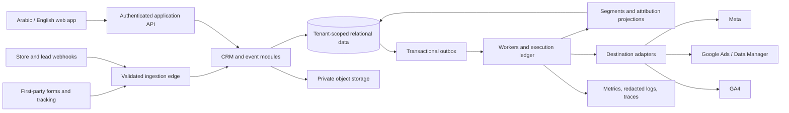
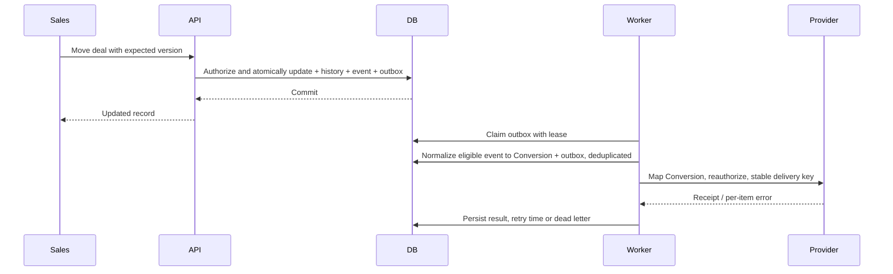

# Architecture design

## Proposed approach
One deployable modular backend and separately runnable workers. One relational primary database, object storage for private attachments, durable outbox, background queue and replaceable provider adapters. This is a logical architecture, not a declaration that a particular framework has been selected.

## Module ownership
| Module | Owns | Does not own |
|---|---|---|
| Identity/tenancy | Memberships, agency grants, permission decisions | CRM identity matching |
| CRM | Contacts, inquiries, opportunities, stage history, tasks | Orders as accounting truth |
| Journey | Immutable business events, touches, identity-link evidence | Provider-reported attribution |
| Conversion | Immutable normalized conversions and appended reversals from eligible business evidence | Provider receipts or destination-specific sales truth |
| Campaigns | External IDs, spend snapshots, taxonomy | Ad budget changes |
| Attribution | Versioned credit calculations and read models | Rewriting source events |
| Segments | Rule AST, membership, audience intent | Provider delivery receipts |
| Integrations | Connections, destinations, inbox/outbox deliveries | Business definitions of qualified/won |
| Operations | Plans, deliverables, approvals, projects | Sales pipeline semantics |
| Automation | Versioned rules and execution ledger | Bypassing current actor/service authorization |
| Privacy/portability | Subject requests, tenant export manifests and suppression lifecycle | Unrestricted data access or secret export |
| Audit | Append-only actor/action evidence | General-purpose business event truth |

Modules communicate through application services and versioned events; avoid arbitrary cross-module writes. Read models may join through documented tenant-scoped views.

## Transaction boundaries
Lead creation or stage change, business event and outbox record commit in one database transaction. Provider calls happen afterward. Queue loss is recoverable by scanning undelivered outbox records. Workers are at-least-once; effects are idempotent. No claim of distributed exactly-once delivery.

## Frozen evidence boundary
BusinessEvent is canonical internal business/journey evidence. Conversion is immutable normalized commercial/conversion evidence derived from an eligible BusinessEvent and its referenced business object under a versioned business definition. Attribution operates on Conversion only. A business object outcome first produces a BusinessEvent; adapters never independently derive conversions from mutable orders/deals.

The conversion normalizer consumes the event, enforces a unique tenant/business-outcome/type identity, and atomically commits Conversion plus conversion outbox message. Reprocessing is a no-op for that identity. Distinct legitimate partial payments have distinct outcome identities; corrections/refunds append linked reversal/correction evidence. A definition or destination mapping change is not permission to emit the same outcome again.

For conversion delivery, the adapter maps **Conversion**, with authorized source-event context, through `mapConversion(conversion, context, mappingVersion)`. Delivery records reference conversion_id and own transport/destination status only. Provider receipts, retries, failures and mappings never redefine internal business truth. Nonconversion analytics can map BusinessEvent through a separate analytics contract and must not emit commercial conversion actions. Audience sync is a separate transport workflow.

## Tenant isolation choices
Preferred custom-build baseline: tenant_id on every business table, composite foreign keys, application authorization plus PostgreSQL row-level security. Runtime DB role must not own/bypass RLS; transaction-local tenant context must be reset safely with connection pooling. Jobs establish tenant context from trusted queue records, not browser input.

If Frappe is chosen, use its site/database-per-tenant architecture and implement explicit agency access through scoped APIs. If Twenty is chosen, verify workspace isolation, enterprise feature boundaries and upgrade behavior. Do not retrofit the custom PostgreSQL model blindly into an upstream framework.

Agency dashboard requests only authorized tenant projections. Platform operations are a separate control plane; cross-tenant customer queries are not a default admin feature.

## Authorization enforcement
Identity/tenancy owns the fixed role/action catalogue, membership and scoped agency grants described in 02/04/07. A client-owned grant targets one active agency membership and can only narrow its role's actions and finite resource scope. Tenant equality and object/field policy are mandatory in application services before reads or mutations, including list filters, reports, exports and private files. Database isolation is defense in depth, not a substitute for action authorization.

Queued commands retain initiating user/membership/grant references and intended tenant/action/object scope, not an everlasting permission snapshot. Workers check current authority before each bounded batch and external side effect; denied work is blocked/cancelled with safe audit evidence. Scheduled system work uses a tenant service principal with explicit actions and current rule/connection/consent checks. Bulk output is rechecked before release/download; cache hits are also authorized before returning data.

## Stack evaluation
Custom candidate: TypeScript web/backend, PostgreSQL, Redis-backed queue with DB outbox recovery, S3-compatible private storage. Libraries and versions selected in M0 after dependency review. Frappe brings a different stack; framework choice is open, not a mandate to combine stacks.

Start with database indexes and scheduled aggregate tables. Add warehouse/search infrastructure only when measured query or event volume requires it. Scale ingestion and workers independently before splitting business services.

## Deployment topology
Development with synthetic data; isolated staging with test destinations; production with managed database backups, secrets manager, TLS and private storage. Separate provider credentials per environment. Database migrations follow expand → backfill → validate → switch → later contract. Backward-compatible event readers cover rolling deployments.
