# Logical data model and ERD

This is a logical ERD, not executable DDL. IDs are opaque UUIDs in a custom implementation. All business entities carry tenant_id, created_at and updated_at unless append-only. Composite keys/FKs enforce tenant equality. USER and TENANT are global control-plane entities; ROLE, PERMISSION and ROLE_PERMISSION are versioned global policy catalogues without customer data; MEMBERSHIP is the bridge. Every other ERD entity is owned by exactly one tenant, including jobs, ledgers and privacy/export artifacts. AGENCY_GRANT is owned by client_tenant_id (its tenant_id); agency_tenant_id explicitly identifies the receiving tenant. CLIENT_ENGAGEMENT is agency-owned; its client_tenant_ref is a control-plane relationship, not permission to join client data.

```mermaid
erDiagram
  TENANT ||--o{ MEMBERSHIP : has
  USER ||--o{ MEMBERSHIP : joins
  ROLE ||--o{ MEMBERSHIP : assigns
  ROLE ||--o{ ROLE_PERMISSION : permits
  PERMISSION ||--o{ ROLE_PERMISSION : defines_action
  TENANT ||--o{ AGENCY_GRANT : client_tenant_id
  TENANT ||--o{ AGENCY_GRANT : agency_tenant_id
  MEMBERSHIP ||--o{ AGENCY_GRANT : agency_member
  AGENCY_GRANT ||--o{ GRANT_PERMISSION : narrows
  PERMISSION ||--o{ GRANT_PERMISSION : allows_action
  TENANT ||--o{ SERVICE_PRINCIPAL : owns
  ROLE ||--o{ SERVICE_PRINCIPAL : limits
  TENANT ||--o{ CONTACT : owns
  CONTACT ||--o{ CONTACT_IDENTIFIER : identifies
  CONTACT o|--o{ CONSENT_RECORD : contact_subject
  VISITOR o|--o{ CONSENT_RECORD : visitor_subject
  CONTACT ||--o{ LEAD : inquires
  CONTACT ||--o{ DEAL : negotiates
  LEAD o|--o{ DEAL : originates
  PIPELINE ||--|{ STAGE : defines
  STAGE ||--o{ DEAL : current_stage
  DEAL ||--o{ STAGE_TRANSITION : changes
  CONTACT o|--o{ TASK : concerns
  DEAL o|--o{ TASK : follows_up
  CONTACT o|--o{ APPOINTMENT : attends
  DEAL o|--o{ APPOINTMENT : schedules
  APPOINTMENT ||--|{ APPOINTMENT_REVISION : retains
  DEAL ||--o{ QUOTE_VERSION : proposes
  CONTACT ||--o{ COMMERCE_ORDER : purchases
  COMMERCE_ORDER ||--o{ ORDER_LINE : contains
  COMMERCE_ORDER ||--o{ PAYMENT : receives
  COMMERCE_ORDER ||--o{ REFUND : reverses
  COMMERCE_ORDER ||--o{ FULFILLMENT : delivers
  CONTACT ||--o{ IDENTITY_LINK : links
  VISITOR ||--o{ IDENTITY_LINK : proves
  VISITOR ||--o{ SESSION : visits
  SESSION ||--o{ TOUCHPOINT : touches
  CAMPAIGN o|--o{ TOUCHPOINT : sources
  AD_ACCOUNT ||--o{ CAMPAIGN : contains
  CAMPAIGN ||--o{ AD : contains
  AD_ACCOUNT ||--o{ SPEND_FACT : reports
  CONTACT o|--o{ BUSINESS_EVENT : relates
  BUSINESS_EVENT ||--o{ CONVERSION : yields
  CONVERSION ||--o{ ATTRIBUTION_CREDIT : receives
  TOUCHPOINT o|--o{ ATTRIBUTION_CREDIT : contributes_or_unknown
  CONNECTION ||--o{ DESTINATION : exposes
  DESTINATION ||--o{ DELIVERY : receives
  CONVERSION o|--o{ DELIVERY : conversion_transport
  BUSINESS_EVENT o|--o{ DELIVERY : analytics_transport
  TENANT ||--o{ INBOX : receives
  INBOX o|--o{ BUSINESS_EVENT : normalizes
  BUSINESS_EVENT o|--o{ OUTBOX : publishes_evidence
  CONVERSION o|--o{ OUTBOX : publishes_conversion
  TENANT ||--o{ AUTOMATION_RULE : configures
  AUTOMATION_RULE ||--|{ AUTOMATION_RULE_VERSION : versions
  AUTOMATION_RULE_VERSION ||--o{ AUTOMATION_RUN : executes
  BUSINESS_EVENT ||--o{ AUTOMATION_RUN : triggers
  AUTOMATION_RUN o|--o{ TASK : creates
  TENANT ||--o{ AUDIT_LOG : audits
  TENANT ||--o{ PRIVACY_REQUEST : processes
  CONTACT o|--o{ PRIVACY_REQUEST : contact_subject
  VISITOR o|--o{ PRIVACY_REQUEST : visitor_subject
  PRIVACY_REQUEST ||--o{ PRIVACY_STEP : tracks
  TENANT ||--o{ TENANT_EXPORT : exports
  SEGMENT ||--|{ SEGMENT_VERSION : defines
  SEGMENT_VERSION ||--o{ SEGMENT_MEMBERSHIP : materializes
  CONTACT ||--o{ SEGMENT_MEMBERSHIP : belongs
  SEGMENT_VERSION ||--o{ AUDIENCE_SYNC : exports
  DESTINATION ||--o{ AUDIENCE_SYNC : targets
  CLIENT_ENGAGEMENT ||--o{ MONTHLY_PLAN : plans
  MONTHLY_PLAN ||--o{ DELIVERABLE : contains
  DELIVERABLE ||--o{ ASSET_VERSION : versions
  ASSET_VERSION ||--o{ APPROVAL : reviews
  DEAL ||--o| SERVICE_PROJECT : starts
  SERVICE_PROJECT ||--o{ MILESTONE : tracks
```

## Core dictionary
| Entity | Principal fields / rules |
|---|---|
| tenant | id, name, timezone, default_currency, status, retention_policy_version |
| user | global authenticated actor ID; no implicit customer-data access |
| role/permission/role_permission | fixed versioned role catalogue; action key, resource class, scope (tenant/assigned), readable/writable field groups; no arbitrary ACL or policy scripting |
| membership | id, tenant_id, user_id, role_id, status; unique tenant/user; one role per membership |
| agency_grant/grant_permission | id, client_tenant_id, agency_tenant_id, agency_membership_id, allowed action keys, optional narrower field groups, scope_kind and optional fixed resource IDs, expires_at, revoked_at; client-issued, both parties audited; receiving membership belongs to agency_tenant_id |
| service_principal | tenant_id, id, role_id, enabled, purpose; restricted system-job role/actions, no global bypass |
| contact | id, tenant_id, display_name, owner_id, lifecycle_state, merged_into_id; no global customer sharing |
| contact_identifier | contact_id, kind, encrypted_value, keyed_lookup_digest, verified_at, provenance; nonunique match candidates for shared phones |
| consent_record | exactly one contact_id or visitor_id, purpose, channel, status, effective_at, collected_at, source, policy_version; append-only; linkage never fabricates consent for another subject |
| lead | contact_id, intake_source, external_source_id, status, owner_id, received_at, first_response_at; qualification state separate from deal stages |
| pipeline/stage | business_profile, version, stage order, terminal outcome, permitted transitions; referenced stages archived, never deleted |
| deal | contact_id, nullable lead_id, pipeline_id, stage_id, amount_minor, currency, owner_id, version, expected_close_at |
| stage_transition | deal_id, from/to stage, occurred_at, actor_id, reason, deal_version, command_id |
| task | assigned user, due_at, outcome, contact_id/deal_id (at least one), optional automation_run_id; assignment validated in owning tenant context |
| appointment/appointment_revision | contact_id/deal_id (at least one), assigned user; immutable revisions contain start/end, outcome, reason, actor, revision number; current revision pointer |
| quote_version | deal_id, quote_group_id, revision, amount_minor, currency, document_ref, status; accepted version fixed |
| commerce_order | contact_id, connection_id, external_id, order_status, payment_status, fulfillment_status, placed_at, currency, gross/discount/tax/shipping/net minor units |
| order_line | order_id, external_product_id, SKU snapshot, quantity, unit/net amount; never infer medical conditions from products |
| payment/refund/fulfillment | order_id, external_id, occurred_at, status; financial entries include amount/currency; refund may link original payment |
| visitor/session | tenant-local opaque ID, session times, collection policy; no IP-based identity merge |
| identity_link | contact_id, visitor_id, evidence_type, evidence_ref, valid_from/to, revoked_at; supports correction/shared devices |
| touchpoint | session_id, optional contact_id, occurred_at, landing path, sanitized UTMs, click identifiers, optional campaign/ad IDs |
| ad_account/campaign/ad | connection_id, provider IDs, name snapshots, account timezone/currency; provider hierarchy supports adset/adgroup external parent IDs |
| spend_fact | account/campaign/ad ref, reporting_date, grain, breakdown_key, currency, spend_minor, fetched_at; provider facts are replaceable snapshots |
| business_event | event_id, name, schema_version, source, source_event_id, occurred_at, received_at, optional contact/visitor/session refs, allowlisted payload, consent_snapshot_ref |
| conversion | conversion_id, event_id, conversion_type, business_object_ref, business_outcome_key, definition_version, occurred_at, value_minor, currency, evidence_kind, reversal_of_id; immutable normalized commercial evidence; no mutable delivery state |
| attribution_credit | conversion_id, optional touchpoint_id for unknown, model_version, calculation_run_id, weight, value_minor, lookback_days; sum weights per tenant/conversion/model/calculation run = 1 |
| connection/destination | provider, owned account/dataset/action IDs, secret_ref, capability_status, permissions, token expiry, disconnected_at; no plaintext tokens |
| delivery | kind (conversion/analytics), conversion_id or analytics_event_id (exactly one), destination_id, mapping_version, idempotency_key, status, attempts, next_attempt_at, provider_receipt, redacted_error; conversion kind always maps Conversion, analytics kind cannot generate conversions |
| segment/version/membership | rule AST/version, evaluated_at, contact_id, entered/exited_at; immutable definitions and reproducible evaluations |
| audience_sync | version_id, destination_id, remote_audience_id, operation, subject manifest reference, status, receipt; removals tracked independently |
| inbox | connection/source namespace, source_event_id, payload reference/hash, received_at, processed_at, result reference; also durable command receipts using namespace command:principal:operation and source_event_id = command_id; identity/hash/result reference retained independently of raw payload and API response cache |
| outbox | message_id, kind, event_id or conversion_id (exactly one for these event messages), initiating principal/grant or service_principal_id, action/scope, payload reference, lease, processed_at; transactional publication |
| automation_rule/automation_rule_version/automation_run | rule enabled state; immutable versioned trigger/conditions/actions; run unique by tenant/rule_version/event/action, status, effect_key, actor/service authority, attempt/error/result; current rule enabled state checked before effect |
| privacy_request/privacy_step | type subject_export/delete, exactly one contact_id or visitor_id, requester/verified authority, status, requested/completed_at; steps track active stores, suppression, backup reapplication, provider removal, errors and unresolved state; minimal suppression tombstone subject to approved retention |
| tenant_export | requester/membership/grant, snapshot/as_of, schema_version, status, dataset manifest/counts/checksums, exclusion reasons, private artifact refs, expires_at, completed_at; DAT-02, not a privacy_request; no credentials/tokens |
| audit_log | tenant, actor, grant, action, object, redacted diff, request_id, occurred_at; restricted append-only |
| client_engagement | owning agency tenant, client_tenant_ref, contract/service metadata; no implicit foreign-tenant access |
| monthly_plan/deliverable | engagement_id, period, objectives, budget/currency, owner, due_at, status |
| asset_version/approval | immutable asset checksum, storage ref, revision; approval has exact version, reviewer, decision, time |
| service_project/milestone | originating deal, scope version, owner, planned/actual dates, acceptance; commercial change has explicit history |

## Integrity and indexing
- All tenant-local references use (tenant_id, id), including polymorphic object references, consent snapshots, reversal links, artifact refs, rule versions and both sides of grants' client resource scopes. Global user references do not grant authority; assignment checks require active direct membership or explicitly scoped agency access in the owning client context. The agency membership reference uses (agency_tenant_id, membership_id); this and the named control-plane tenant references above are intentional exceptions, never general cross-tenant joins.
- Unique: (tenant, connection, source_event_id) for inbox; (tenant, event_id) for events; (tenant, destination, idempotency_key) for delivery.
- Sources without a connection use a stable source namespace; source dedup is unique by tenant/source namespace/source_event_id. API retry-cache expiry never drops these identities. Raw payload expiry is independent; minimal dedup/suppression tombstones prevent resurrection under an approved retention policy (OQ-09).
- Effect-producing manual commands supply a stable command_id retained in INBOX's command namespace; receipt, domain effect and BusinessEvent/outbox commit atomically. Reusing that identity with a different request hash is a conflict even after the API response cache expires; replay resolves the authorized existing result or a safe unavailable/tombstoned status, never a new effect. A new intentional command needs a new identity and current domain/version validation.
- Unique Conversion: (tenant, conversion_type, business_outcome_key), with originating event and definition version retained. Multiple BusinessEvents for one outcome do not create another Conversion. Corrections/reversals use a new evidenced outcome key and link the original; never mutate it or create a destination-specific conversion truth.
- Every Delivery has exactly one conversion or nonconversion analytics source, in the same tenant as its destination/connection. Provider delivery idempotency key is stable across retries and mapping changes; a mapping version alone cannot authorize duplicate send effects. Attribution references Conversion; unknown attribution has null touchpoint_id, not a fabricated touch.
- Consent and privacy requests reference exactly one contact or visitor; contact/deal links on tasks and appointments must agree where both are present. Agency grant action scope and field permissions can only narrow role permissions. AUDIT_LOG actor/grant references preserve the real initiating identity without implying authorization.
- Unique order: (tenant, connection, external_id). Financial event IDs deduplicate separately from order updates.
- Deal stage must belong to its pipeline; history append and deal update are one transaction.
- Use integer minor units and ISO currency; never aggregate mixed currencies without explicit dated FX conversion. Decimal quantities for products where needed.
- Store timestamps UTC plus source timezone/offset when relevant; dates for ad reporting retain account-local meaning.
- Index (tenant, stage, owner), (tenant, contact, occurred_at), (tenant, event_name, occurred_at), (tenant, status, next_attempt_at).
- Unlinked anonymous events are valid. Avoid contact_id NOT NULL on the event stream.
- Source events remain immutable except authorized redaction/deletion; reporting projections are rebuildable and carry their computation version.
- Plan/approval tables are P1; billing tables are deferred to P2. This ERD deliberately does not pretend to be an ERP schema.
