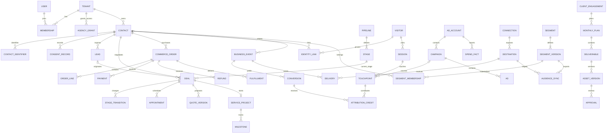

# Logical data model and ERD

This is a logical ERD, not executable DDL. IDs are opaque UUIDs in a custom implementation. All business entities carry tenant_id, created_at and updated_at unless append-only. Composite keys/FKs enforce tenant equality. User and tenant are global control-plane entities; membership is the bridge.

## Core dictionary
| Entity | Principal fields / rules |
|---|---|
| tenant | id, name, timezone, default_currency, status, retention_policy_version |
| membership | tenant_id, user_id, role, status; unique tenant/user |
| agency_grant | client tenant_id, agency_tenant_id, scoped permissions, expires_at, revoked_at; both parties audited |
| contact | id, tenant_id, display_name, owner_id, lifecycle_state, merged_into_id; no global customer sharing |
| contact_identifier | contact_id, kind, encrypted_value, keyed_lookup_digest, verified_at, provenance; nonunique match candidates for shared phones |
| consent_record | contact/visitor reference, purpose, channel, status, effective_at, collected_at, source, policy_version; append-only |
| lead | contact_id, intake_source, external_source_id, status, owner_id, received_at, first_response_at; qualification state separate from deal stages |
| pipeline/stage | business_profile, version, stage order, terminal outcome, permitted transitions; referenced stages archived, never deleted |
| deal | contact_id, nullable lead_id, pipeline_id, stage_id, amount_minor, currency, owner_id, version, expected_close_at |
| stage_transition | deal_id, from/to stage, occurred_at, actor_id, reason, deal_version, command_id |
| task/appointment | owner, due/start/end time, outcome, contact/deal reference; appointment revisions retain history |
| quote_version | deal_id, quote_group_id, revision, amount_minor, currency, document_ref, status; accepted version fixed |
| commerce_order | contact_id, connection_id, external_id, order_status, payment_status, fulfillment_status, placed_at, currency, gross/discount/tax/shipping/net minor units |
| order_line | order_id, external_product_id, SKU snapshot, quantity, unit/net amount; never infer medical conditions from products |
| payment/refund/fulfillment | order_id, external_id, occurred_at, status; financial entries include amount/currency; refund may link original payment |
| visitor/session | tenant-local opaque ID, session times, collection policy; no IP-based identity merge |
| identity_link | contact_id, visitor_id, evidence_type, evidence_ref, valid_from/to, revoked_at; supports correction/shared devices |
| touchpoint | session_id, optional contact_id, occurred_at, landing path, sanitized UTMs, click identifiers, optional campaign/ad IDs |
| ad_account/campaign/ad | connection_id, provider IDs, name snapshots, account timezone/currency; provider hierarchy supports adset/adgroup external parent IDs |
| spend_fact | account/campaign/ad ref, reporting_date, grain, breakdown_key, currency, spend_minor, fetched_at; provider facts are replaceable snapshots |
| business_event | event_id, name, schema_version, source, source_event_id, occurred_at, received_at, optional contact/visitor/session refs, allowlisted payload, consent_snapshot_ref |
| conversion | event_id, conversion_type, business_object_ref, value_minor, currency, state, reversal_of_id; immutable commercial evidence |
| attribution_credit | conversion_id, optional touchpoint_id for unknown, model_version, calculation_run_id, weight, value_minor, lookback_days; sum weights per run = 1 |
| connection/destination | provider, owned account/dataset/action IDs, secret_ref, capability_status, permissions, token expiry, disconnected_at; no plaintext tokens |
| delivery | event_id, destination_id, mapping_version, idempotency_key, status, attempts, next_attempt_at, provider_receipt, redacted_error |
| segment/version/membership | rule AST/version, evaluated_at, contact_id, entered/exited_at; immutable definitions and reproducible evaluations |
| audience_sync | version_id, destination_id, remote_audience_id, operation, subject manifest reference, status, receipt; removals tracked independently |
| inbox/outbox | tenant_id, source/message key, payload reference, lease, processed_at; durable ingestion and event publication |
| automation_rule/run | versioned trigger/conditions/actions; run unique by tenant/rule_version/event/action |
| audit_log | tenant, actor, grant, action, object, redacted diff, request_id, occurred_at; restricted append-only |
| client_engagement | owning agency tenant, client_tenant_ref, contract/service metadata; no implicit foreign-tenant access |
| monthly_plan/deliverable | engagement_id, period, objectives, budget/currency, owner, due_at, status |
| asset_version/approval | immutable asset checksum, storage ref, revision; approval has exact version, reviewer, decision, time |
| service_project/milestone | originating deal, scope version, owner, planned/actual dates, acceptance; commercial change has explicit history |

## Integrity and indexing
- All tenant-local references use (tenant_id, id); membership checks constrain owner/user assignment.
- Unique: (tenant, connection, source_event_id) for inbox; (tenant, event_id) for events; (tenant, destination, idempotency_key) for delivery.
- Unique order: (tenant, connection, external_id). Financial event IDs deduplicate separately from order updates.
- Deal stage must belong to its pipeline; history append and deal update are one transaction.
- Use integer minor units and ISO currency; never aggregate mixed currencies without explicit dated FX conversion. Decimal quantities for products where needed.
- Store timestamps UTC plus source timezone/offset when relevant; dates for ad reporting retain account-local meaning.
- Index (tenant, stage, owner), (tenant, contact, occurred_at), (tenant, event_name, occurred_at), (tenant, status, next_attempt_at).
- Unlinked anonymous events are valid. Avoid contact_id NOT NULL on the event stream.
- Source events remain immutable except authorized redaction/deletion; reporting projections are rebuildable and carry their computation version.
- Plan/approval tables are P1; billing tables are deferred to P2. This ERD deliberately does not pretend to be an ERP schema.
