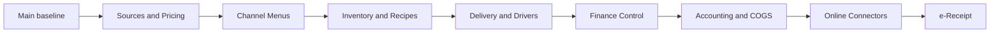
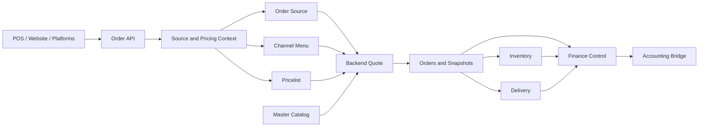

# YAKEBDA MS — Diagrams Roadmap v2.1

## Program Sequence

## Target Architecture

## Required Diagrams

- YKMS-11: ERD، Quote Sequence، Repricing State.
- YKMS-12: Publishing، Mapping، Sync.
- YKMS-13: Inventory ERD، Movement، Deduction.
- YKMS-14: Dispatch، Driver State، Settlement.
- YKMS-15: Expense State، Reconciliation.
- YKMS-16: Posting، Reversal، Backfill.
- YKMS-17: Adapter، Webhook Retry.
- YKMS-18: Submission، Retry، Status.

