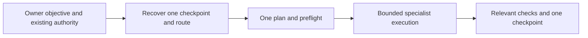

# TSST — one working method, every runtime

Current operational procedure, 2026-10-12. Approved scope: Ahmed's request to repair the decision-review findings and simplify recent TSST work. No change to team readiness or reserved actions.

## One task packet

The Lead owns the user's conversation. Load boot.md, core rules and only the current track's pointers and matched skills. Read a skill body before applying it; the index trigger is discovery only. A current checkpoint replaces replaying completed work. Refresh changed policy/source/branch evidence when it changes; do not reread the entire repository before each tool call.

Keep one task plan in its existing job brief or bounded handoff; reference it from the bus and worker prompt rather than creating three independent versions. The plan contains TEAM, AGENT, SKILLS, NOT_SELECTED, TIER, ACCEPTANCE and SKILL_GAP, plus runtime, track, read/write scope, the existing owner-authorization reference and contract loading mode. JSON is the executable form; prompts may carry the same fields. The reader uses SKILLS none and FAST; it returns evidence input, not a specialist deliverable. At most three skills, or a concrete skill_limit_reason.

A direct owner instruction to perform the identified repair authorizes that repair scope. The Lead states the bounded items and usage/cash implications, continues inside that authority, and asks only about material missing scope or a reserved action. Silence grants nothing. A new audit/fix proposal still needs its numbered scope and cost approved before execution. R16/R24 do not require asking again for an already authorized step.

## One preflight before execution

`python -B TSST/context/preflight.py --plan <existing-plan.json> --mutate --json`

The agent runs this internal command; Ahmed need not fill forms or run it manually. The script is read-only: --mutate selects stricter validation, it does not perform the requested writes. Without --mutate it can inspect a mismatched branch with a warning to recover context. Mutation validates the original workspace, actual Git root/track branch, plan, scoped authority declaration, referenced skills and the declared TSST contract. It records hashes of the sources actually read. Rerun after a relevant change to branch, plan, rules, skill or contract; one receipt covers unchanged scoped work.

A receipt proves these inputs passed validation. It does not authenticate a human, prove an agent understood a skill, prove native custom-agent registration, or override tool/sandbox permissions. If validation fails, stop the affected mutation and show the exact missing input. Do not switch to an ungoverned worker or silently continue.

Prefer the runtime's native named agent when supported and verified. If the exposed runtime offers no native config selector, use the adapter's explicit-contract mode: a bounded named TSST specialist, its generated contract actually opened, its indexed skill bodies loaded, and declared mode/path/hash in the packet. This is the same roster and method, not a new agent role. Report native loading as unverified. If the runtime cannot carry that contract, return a capability blocker; do not claim a dispatch occurred. The main-session Lead is never spawned.

Claude Agent/Task dispatch uses the shared plan validator through its hook. Codex and other file-capable runtimes call the same preflight explicitly; a repository instruction is not a verified tool interceptor. A manual ChatGPT/Gemini surface without shell or repository write access prepares the bounded packet only; the receiving file-capable TSST host runs preflight before applying it. Ahmed does not run the gate manually. Read-only quick answers need neither --mutate nor a new persisted JSON packet; they still use the routed reader/Lead and existing source authority. Generated-agent --check proves file consistency only. Runtime adapters contain access/model mechanics, not alternate authority or workflow.

## Execute and close once

Only the needed specialists work on non-overlapping scopes. Resume the same unfinished agent with the missing step; do not restart it to reread everything. One bounded implementation plus relevant regression checks is normal. More checks are justified by a changed dependency, a new failure or destructive risk; a short status lookup does not trigger a full audit.

Use the bus for an actual queued/cross-runtime handoff, claim, lease, dependency or usage-limit recovery. A direct Lead session is ROLE A and does not need a dummy bus task solely to establish identity. Do not fabricate a bus claim. Daily-board collect/plan/lock starts only when Ahmed says ابدأ اليوم; check an already locked board and obey it, but no board today does not by itself block a separately authorized task.

End with one current checkpoint: done, evidence, open items, do_not_repeat and one exact next action. Link detailed logs instead of repeating them in every packet. Log non-none skill friction in the strict schema; a recorded gap is still open until an approved correction has evidence. Skill use, generated files and passing reference tests never promote readiness.

Client jobs still follow R18–R20, the shared Delivery System and owner acceptance. Utility evidence packets, quick answers and internal governance checkpoints are not new client jobs. DELIVERY.json is authoritative; generated TSST_JOB_SYNC records are derived mirrors, not another editable status store. job_check's normal result verifies structured agreement; narrative truth and release authorization still require review. --structure-only is an explicitly incomplete legacy inspection and never a full delivery PASS.

## Canonical source and portability

Work remains in the original Drive repository and canonical TSST/Real Memory. Keep common changes on their track branch, commit only owned scope, preserve other sessions' WIP. A shared checkout has one branch for every chat using that folder; it cannot display a different branch per chat. Read-only status/history work uses git show/branch/worktree inspection without checkout unless the owner requested a switch. An owner-requested switch still changes all those chats: recheck branch before the next affected write or commit and coordinate the finish/return order. Do not silently switch it back repeatedly. Preflight never changes the branch. A feature-branch commit does not distribute itself to another checkout; preflight must not bless an old copy as the original. Propagation or merging to master remains separately governed. External tools stay ROLE B, with R41's two-stage production/delivery scope and exact allowlist; no implicit spend, publication or account mutation.
