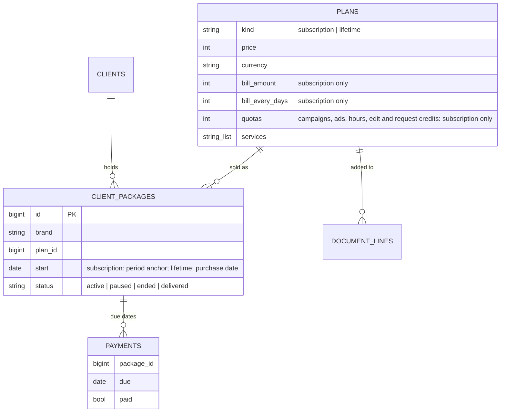

# DASH-PKG-001: packages v3 (monthly + lifetime, many per client, packages on invoices)

Status: SPEC APPROVED by Ahmed 2026-10-26 (decisions A–C below). Repo `C:/Work/tsst-portal` (`main`).
Steps after approval: 2 data + API → 3 invoice / quotation lines → 4 UI/UX audit (read only) → 5 deploy.

## Owner asks (2026-10-26)
1. Some packages are **lifetime** (bought once, no start or end), e.g. Brand setup.
2. A client can hold **more than one package**: monthly ones and lifetime ones at the same time.
3. Any package from the catalog can be added to an **invoice or quotation**.
4. A full audit of packaging, including a UI/UX review against R49–R53.

## What exists today (verified in code)
| Area | Today | Blocks |
|---|---|---|
| `portal.plans` | `period` locked to `'month'` (CHECK) | ask 1 |
| `portal.brand_packages` | `brand` is the PRIMARY KEY, so one package per client | ask 2 |
| `portal.payments` | key `(brand, due)`; schedule computed from one plan | ask 2 |
| `getPackage(brand)` | used by owner, team-read, client-scope, time, documents, reports (one package assumed) | ask 2 |
| Documents | start = Blank or "Monthly package"; package services come in as rows at price 0; total = `value_override` | ask 3 |

## Model

## Rules
1. **Two kinds.** `subscription` = today's behaviour (price per month, billed `bill_amount` every `bill_every_days`,
   quotas per period). `lifetime` = one price, no period, no quotas, no renewal; it has a services list and moves
   Active → Delivered.
2. **Many per client.** A client holds any number of packages; the same subscription plan twice is refused while one
   is active.
3. **Quotas.** The client's "this period" window is anchored on the earliest active subscription. Included campaigns,
   ads, hours and credits = the sum of all active subscriptions in that window, plus bonuses (unchanged).
4. **Payments per package.** Subscription: the schedule from its start (pause rules unchanged). Lifetime: one payment
   due on the purchase date (see decision A). Mark paid works per package.
5. **Invoice / quotation lines.** "Add package" opens the catalog (subscription and lifetime, archived hidden). Each
   package becomes one line: name, short services list as the description, quantity (months for a subscription,
   1 for lifetime), unit price from the catalog, line total. "Start from client's packages" prefills one line per
   active package. Free lines stay. Total = sum of lines − discount. The old "package value" override stays only on
   documents created before this change.
6. **Client view and Home.** The single package card becomes a list: subscriptions first (usage bars as today), then
   lifetime packages as "Owned" with their status. Visibility switches unchanged.
7. **Reports.** Monthly revenue counts subscriptions only; lifetime sales appear as one-time revenue in their month.
8. **No data loss.** Migration 022: `brand_packages` gets an `id` key and `status`; each existing row (ANVIL) becomes
   one subscription package; payments move to `package_id` with the same dues and paid marks. ANVIL's schedule and
   card must look the same after the migration.
9. **UI rules.** HeroUI only (R50), action buttons and colours (R51), no borders (R53), review words (R49). Checked at
   1440 / 1024 / 390, light + dark, with real-length names before review.

## API changes (contract: DASH-API.md, Lead edits it at step 2)
| Endpoint | Change |
|---|---|
| `GET/POST/PATCH settings/plans` | add `kind`; subscription fields required only for `subscription` |
| `GET client/packages?brand=` | new: list of the client's packages (cards) |
| `POST client/packages?brand=` | new: add a package (`plan_id`, `start`) |
| `PATCH client/packages/{id}` | new: start, pause / resume, end, mark delivered (lifetime) |
| `PUT client/package` | kept one release for old screens, then removed |
| `POST client/payments/paid` | add `package_id` |
| Documents rows | add `plan_id?`, `qty`, `unit_price`; `price` = qty × unit price |

## Owner decisions (2026-10-26)
- **A. Lifetime payment:** one payment only, due on the purchase date. Installments are out of scope.
- **B. Line price on invoices:** catalog price prefilled, editable per line.
- **C. Builder:** Claude team, `tsst-dev` (TEAM build).

## Steps and done-when
| # | Step | Done when |
|---|---|---|
| 2 | Migration 022 + service + API + tests | all tests pass; ANVIL card and schedule unchanged; a client with 2 subscriptions + 1 lifetime returns correct quotas and payments |
| 3 | Invoice / quotation package lines | an invoice with Brand setup (lifetime) + a monthly package × 3 months totals correctly in EGP and USD; PDF shows the lines |
| 4 | UI/UX audit (CREATIVE, read only) of Settings › Packages, client package area, client Plan page, document editor | numbered fix list with 2–4 screenshots per screen; fixes folded into one build round |
| 5 | Deploy | after Ahmed's OK |

Out of scope: package-to-project links, automatic invoice generation, online payments.
